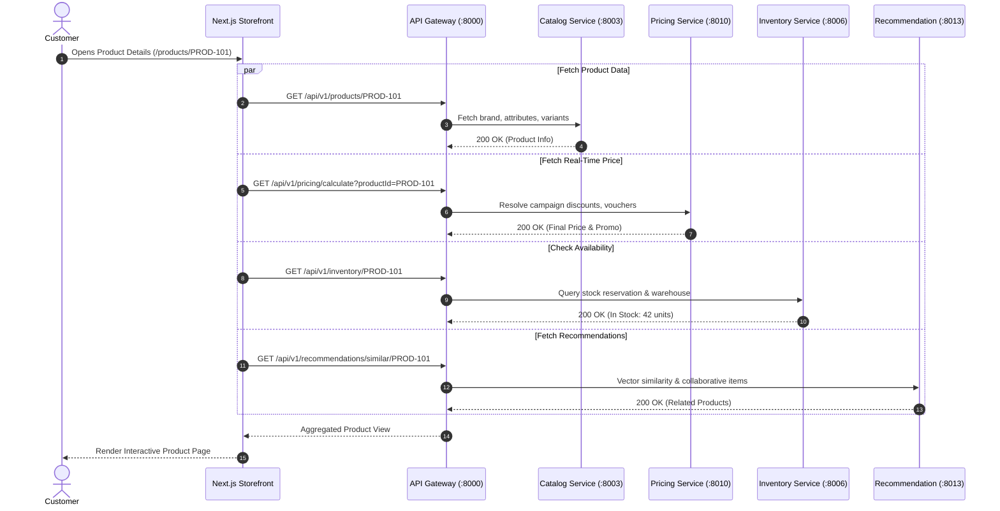
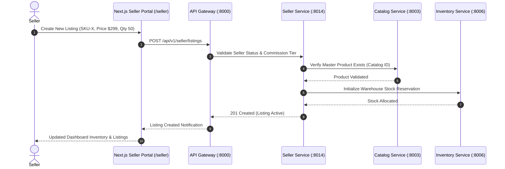

# Unified Next.js E-Commerce Frontend Architecture
## Multi-Actor Separation: Customer, Seller, and Admin Experiences

---

## 1. Executive Summary & Core Philosophy

The modern e-commerce marketplace (such as Amazon, Shopee, or Shopify) serves three fundamentally distinct stakeholders with disparate workflows, interfaces, data access requirements, and security domains:

1. **Customers (Buyers)**: Discover products, search, compare pricing, manage carts, execute checkout, track shipments, and submit verified reviews.
2. **Sellers (Merchants)**: Onboard stores, manage listings, monitor inventory levels, fulfill seller-fulfilled orders, configure promotions, inspect customer feedback, and track payout metrics.
3. **Administrators (Platform Control Plane)**: Govern the ecosystem, approve sellers, curate catalogs, audit dispute payments, broadcast system notifications, monitor fleet health, and track immutable audit logs.

### The Single-Codebase Multi-Experience Paradigm

Rather than deploying three fragmented frontend applications that duplicate design tokens, authentication helpers, API client infrastructure, and UI components, the platform consolidates all three actor experiences into **a single Next.js + TypeScript codebase** using Next.js App Router route groups and layout isolation:

```
                         FRONTEND
                   Next.js + TypeScript
                           │
            ┌──────────────┼──────────────┐
            │              │              │
            ▼              ▼              ▼
        CUSTOMER         SELLER         ADMIN
       EXPERIENCE      EXPERIENCE     CONTROL PLANE
        (/shop)         (/seller)       (/admin)
            │              │              │
            └──────────────┼──────────────┘
                           ▼
                     API GATEWAY
                    Port 8000 (Go)
                           │
         ┌─────────────────┼─────────────────┐
         │                 │                 │
         ▼                 ▼                 ▼
   Customer APIs      Seller APIs       Admin APIs
   (/api/v1/...)   (/api/v1/seller/..) (/api/v1/admin/..)
         │                 │                 │
         ▼                 ▼                 ▼
  13 Business Svc    Seller Service     Admin Service
                         (#15)              (#16)
```

---

## 2. Directory Structure & App Router Layouts

The Next.js repository organizes actor experiences into dedicated directory trees, each possessing its own root layout, theme configuration, navigation header, and authorization boundary:

```
frontend/
├── app/
│   ├── (shop)/                   # Customer Shopping Experience
│   │   ├── page.tsx              # Marketplace Homepage & Spotlight
│   │   ├── layout.tsx            # Customer Navbar, Cart Drawer, Footer
│   │   ├── products/             # Product catalog & category filtering
│   │   │   ├── page.tsx
│   │   │   └── [productId]/      # Product detail, variants, stock, reviews
│   │   ├── search/               # Search results & facet filters
│   │   ├── cart/                 # Full-page cart summary & voucher input
│   │   ├── checkout/             # Multi-step checkout & payment selection
│   │   ├── orders/               # Customer order history & live delivery tracker
│   │   │   └── [orderId]/
│   │   └── account/              # Profile, address book, saved payment tokens
│   │
│   ├── seller/                   # Seller Marketplace Experience
│   │   ├── layout.tsx            # Seller Sidebar, Store Switcher, Metric Header
│   │   ├── dashboard/            # Sales velocity, revenue metrics, orders pending
│   │   ├── store/                # Store profile, branding, shipping policies
│   │   ├── listings/             # SKU management, product mapping, pricing
│   │   ├── inventory/            # Warehouse allocations & reorder alerts
│   │   ├── orders/               # Merchant fulfillment & packing slips
│   │   ├── promotions/           # Store vouchers, flash sale submissions
│   │   ├── reviews/              # Product review monitoring & seller responses
│   │   └── settings/             # Bank payouts, API keys, notification hooks
│   │
│   ├── admin/                    # Platform Control-Plane Experience
│   │   ├── layout.tsx            # Control-plane sidebar, security audit badge
│   │   ├── dashboard/            # Executive GMV, fleet telemetry, active sellers
│   │   ├── users/                # Customer user management & lockout toggles
│   │   ├── sellers/              # Merchant KYC verification, commission tiers
│   │   ├── products/             # Catalog moderation, taxonomy, brand approvals
│   │   ├── orders/               # Cross-seller order inspection & intervention
│   │   ├── payments/             # Gateway disputes, chargebacks, escrow releases
│   │   ├── inventory/            # Global warehouse overview & stock sync audits
│   │   ├── reviews/              # Spam filtering & moderation queues
│   │   ├── deployments/          # Fleet container statuses, release rollback
│   │   ├── system/               # Kafka lag, Redis memory, DB pool monitors
│   │   └── audit-logs/           # Chronological administrative action history
│   │
│   ├── auth/                     # Unified Authentication Flow
│   │   ├── login/                # Password / OAuth / Persona switcher
│   │   └── register/             # Buyer or Seller registration toggle
│   │
│   ├── layout.tsx                # Global HTML, Inter font, Toast providers
│   └── globals.css               # Tailwind tokens, glassmorphism utilities
│
├── components/
│   ├── shop/                     # Customer components (ProductCard, CartDrawer)
│   ├── seller/                   # Seller components (ListingForm, RevenueChart)
│   ├── admin/                    # Admin components (AuditTable, MetricCards)
│   └── ui/                       # Shared atomic UI (Button, Modal, Input, Badge)
│
├── lib/
│   ├── api/
│   │   ├── client.ts             # Central Axios/Fetch wrapper with JWT injection
│   │   ├── customer.api.ts       # Typed Customer API calls
│   │   ├── seller.api.ts         # Typed Seller API calls
│   │   └── admin.api.ts          # Typed Admin API calls
│   └── auth/                     # Token decode & RBAC validation helpers
│
├── stores/
│   ├── auth.store.ts             # Active user, JWT token, active role persona
│   ├── cart.store.ts             # Customer active cart items & totals
│   └── ui.store.ts               # Global modals, theme mode, notification drawer
│
└── middleware.ts                 # Next.js Route Protection & Role Guard
```

---

## 3. Deep Dive into the 3 Actor Experiences

### 3.1. Actor 1: Customer (Buyer) Experience

The customer experience focuses entirely on shopping efficiency, speed, visual appeal, and trust.

- **Primary Route**: `/`
- **Authentication**: Optional for browsing; mandatory for Cart operations, Checkout, Orders, and Reviews.
- **Key Page Capabilities**:
  - **Dynamic Catalog**: Instant search across OpenSearch indices (`search-service:8004`), category drill-down (`catalog-service:8003`).
  - **Real-Time Price & Promotion Engine**: Dynamic discounts, tiered bundle pricing, and voucher calculations (`pricing-service:8010`).
  - **Available-to-Promise Inventory**: Real-time stock reservation confirmation (`inventory-service:8006`).
  - **Single-Click Checkout**: Payment tokenization, address validation, and order submission (`order-service:8007`, `payment-service:8008`).
  - **Personalized Recommendations**: "Frequently Bought Together" and collaborative-filtered feeds (`recommendation-service:8013`).



---

### 3.2. Actor 2: Seller (Merchant) Experience

Sellers are independent marketplace partners who need dedicated tools to manage their digital store, process sales, and coordinate warehouse stock.

- **Primary Route**: `/seller`
- **Authentication**: Strict — Requires `SELLER` role and approved merchant verification.
- **Key Page Capabilities**:
  - **Listing Management**: Map seller SKUs to global Catalog IDs, define variant pricing, set stock buffers.
  - **Order Fulfillment**: Track merchant-fulfilled items, generate shipping manifests, request courier pickups (`shipping-service:8009`).
  - **Store Performance**: Review analytics, customer dispute resolutions, feedback moderation responses (`review-service:8011`).

#### Domain Ownership Boundary: Seller vs. Catalog vs. Inventory vs. Pricing

A common architectural trap in multi-tenant marketplaces is conflating Seller data with Catalog or Inventory data. The platform enforces strict boundary ownership:

| Domain | Owning Microservice | What It Owns | What It Does NOT Own |
|---|---|---|---|
| **Seller / Store** | `seller-marketplace-service` (:8014) | Seller identity, Store name, Onboarding status, Commission rates, Payout rules | Global product taxonomy, stock balances |
| **Catalog** | `catalog-service` (:8003) | Global Master Product (UPC/EAN), Brand, Category hierarchy, Specifications | Seller pricing, warehouse quantities |
| **Inventory** | `inventory-service` (:8006) | Warehouse locations, Available stock counts, Reservations, Allocation locks | Seller business terms, product descriptions |
| **Pricing** | `promotion-pricing-service` (:8010) | Final sale price calculation, Volume discounts, Seasonal campaigns, Coupons | Stock availability, Seller banking credentials |



---

### 3.3. Actor 3: Admin (Platform Control Plane)

Administrators require an executive, high-privilege control center to supervise all marketplace activities.

- **Primary Route**: `/admin`
- **Authentication**: Strict — Requires `ADMIN` role with granular sub-role authorization (`SUPER_ADMIN`, `CATALOG_ADMIN`, `ORDER_ADMIN`, `FINANCE_ADMIN`, `MODERATOR`).
- **Key Page Capabilities**:
  - **Executive Dashboard**: Real-time GMV counters, cross-tenant daily aggregation trends, active user counts.
  - **Merchant Governance**: Approve new seller registrations, adjust commission rates, freeze rogue stores.
  - **Catalog Curation**: Moderate user-generated product listings, manage category trees and attributes.
  - **Financial Control**: Review high-value refunds, resolve chargeback disputes, inspect payout schedules.
  - **Fleet & System Telemetry**: View status and metrics across all 16 microservices, trigger cache flushes, and view deployment history.
  - **Immutable Audit Trail**: Chronological log of every administrative command with diff snapshots.

#### The Golden Architectural Rule of Admin Service

> **Admin Service orchestrates authorized administrative operations through downstream microservice APIs; it NEVER directly accesses another microservice's private database.**

```
CORRECT:
Admin Frontend ──> API Gateway ──> Admin Service ──(REST / gRPC)──> Payment Service ──> payment_db
                                                                         │
                                                                         ▼
                                                                  Payment Provider

INCORRECT:
Admin Frontend ──> API Gateway ──> Admin Service ──(SQL direct)──> payment_db ❌
```

---

## 4. Actor-to-Service Communication Matrix

| Microservice | Port | Customer Experience | Seller Experience | Admin Control Plane | Public / Guest |
|---|---|---|---|---|---|
| **#01 Auth Service** | `8001` | Sign up, login, refresh token | Merchant sign in, 2FA validation | Admin login, MFA, session revoke | Public login |
| **#02 User Service** | `8002` | View profile, addresses | Seller contact info | Ban user, inspect accounts | None |
| **#03 Catalog Service** | `8003` | Browse catalog, view specs | Link SKU to master product | Approve brands, edit taxonomy | Browse catalog |
| **#04 Search Service** | `8004` | Full-text product search, facets | Search own store listings | Search across all entities | Search catalog |
| **#05 Cart Service** | `8005` | Add to cart, update quantities | — | View abandoned cart metrics | Guest cart |
| **#06 Inventory Service** | `8006` | Check item availability | Set warehouse stock allocations | Global stock audits, re-allocations | Check availability |
| **#07 Order Service** | `8007` | Create order, cancel order | Update fulfillment status | Cancel order, trigger refund | — |
| **#08 Payment Service** | `8008` | Process payment, save cards | View payout balance | Review disputes, process refund | — |
| **#09 Shipping Service** | `8009` | Track package delivery | Print labels, dispatch package | Audit carrier SLA, tracking overrides | Track tracking # |
| **#10 Promotion / Pricing** | `8010` | Apply coupon, view discounts | Create store vouchers | Create platform-wide flash sales | View public discounts |
| **#11 Review / Rating** | `8011` | Write review, rate purchase | Respond to customer review | Moderate reviews, delete spam | Read reviews |
| **#12 Notification Service** | `8012` | Order & shipping alerts | Payout & order alerts | Broadcast system announcements | — |
| **#13 Recommendation Service** | `8013` | Personalized recommendations | View trending items | Inspect model training status | Popular products |
| **#14 Seller Service** | `8014` | View seller store page | Full store management | Verify seller KYC, commissions | View seller store |
| **#15 Admin Service** | `8015` | — | — | Full control plane orchestration | — |

---

## 5. Authentication, Authorization & Route Protection

### 5.1. Authentication vs. Authorization

- **Authentication ("Who are you?")**: Verified by `auth-service` (#01). Returns a signed JWT containing `sub` (User ID), `email`, and assigned `roles` array.
- **Authorization ("What can you do?")**: Enforced at two layers:
  1. **Frontend Layer**: Next.js Edge Middleware (`middleware.ts`) verifies token validity and role claims before serving protected HTML/JS bundles.
  2. **Gateway & Backend Layer**: API Gateway and microservice route handlers enforce cryptographically verified claims, ensuring direct API requests cannot bypass UI guards.

### 5.2. Role Hierarchy

```
USER
 ├── CUSTOMER (Default buyer access)
 ├── SELLER   (Store management privileges)
 └── ADMIN    (Platform oversight)
       ├── SUPER_ADMIN    (All permissions across all domains)
       ├── CATALOG_ADMIN  (Catalog, categories, brands)
       ├── ORDER_ADMIN    (Order processing, cancellations, shipping)
       ├── FINANCE_ADMIN  (Payments, refunds, payouts, taxes)
       └── MODERATOR      (Reviews, complaints, content bans)
```

A user account can possess multiple roles simultaneously:
```json
{
  "sub": "usr_99812",
  "email": "sarah.merchant@example.com",
  "roles": ["CUSTOMER", "SELLER"],
  "sellerId": "sel_0412",
  "exp": 1789456000
}
```

---

## 6. Next.js Edge Middleware Specification

The Next.js Edge Middleware (`frontend/middleware.ts`) inspects every incoming request before routing:

```typescript
import { NextResponse } from 'next/server';
import type { NextRequest } from 'next/server';

export function middleware(request: NextRequest) {
  const { pathname } = request.nextUrl;
  const token = request.cookies.get('accessToken')?.value;
  const userRole = request.cookies.get('userRole')?.value;

  // 1. Public routes: Customer storefront, catalog, search, auth
  if (
    pathname === '/' ||
    pathname.startsWith('/products') ||
    pathname.startsWith('/search') ||
    pathname.startsWith('/auth')
  ) {
    return NextResponse.next();
  }

  // 2. Customer protected routes: Cart checkout, account, order history
  if (
    pathname.startsWith('/cart') ||
    pathname.startsWith('/checkout') ||
    pathname.startsWith('/orders') ||
    pathname.startsWith('/account')
  ) {
    if (!token) {
      const loginUrl = new URL('/auth/login', request.url);
      loginUrl.searchParams.set('returnUrl', pathname);
      return NextResponse.redirect(loginUrl);
    }
    return NextResponse.next();
  }

  // 3. Seller portal routes: /seller/*
  if (pathname.startsWith('/seller')) {
    if (!token) {
      const loginUrl = new URL('/auth/login', request.url);
      loginUrl.searchParams.set('returnUrl', pathname);
      return NextResponse.redirect(loginUrl);
    }
    if (userRole !== 'SELLER' && userRole !== 'ADMIN') {
      // Forbidden: Redirect to seller onboarding or access denied
      return NextResponse.redirect(new URL('/auth/login?error=seller_required', request.url));
    }
    return NextResponse.next();
  }

  // 4. Admin control plane routes: /admin/*
  if (pathname.startsWith('/admin')) {
    if (!token) {
      const loginUrl = new URL('/auth/login', request.url);
      loginUrl.searchParams.set('returnUrl', pathname);
      return NextResponse.redirect(loginUrl);
    }
    if (userRole !== 'ADMIN') {
      return NextResponse.redirect(new URL('/auth/login?error=admin_required', request.url));
    }
    return NextResponse.next();
  }

  return NextResponse.next();
}

export const config = {
  matcher: ['/((?!api|_next/static|_next/image|favicon.ico).*)'],
};
```

---

## 7. API Gateway Routing Map

The API Gateway (`api-gateway:8000`) acts as the single unified reverse proxy for all three frontend portals:

| Frontend Client Endpoint | Gateway Route Path | Destination Microservice | Port |
|---|---|---|---|
| Customer / Seller / Admin | `/api/v1/auth/*` | `auth-service` | `8001` |
| Customer / Seller / Admin | `/api/v1/users/*` | `user-service` | `8002` |
| Customer / Seller / Admin | `/api/v1/products/*` | `catalog-service` | `8003` |
| Customer / Seller / Admin | `/api/v1/search/*` | `search-service` | `8004` |
| Customer Storefront | `/api/v1/cart/*` | `cart-service` | `8005` |
| Customer / Seller / Admin | `/api/v1/inventory/*` | `inventory-service` | `8006` |
| Customer / Seller / Admin | `/api/v1/orders/*` | `order-service` | `8007` |
| Customer / Admin | `/api/v1/payments/*` | `payment-service` | `8008` |
| Customer / Seller / Admin | `/api/v1/shipping/*` | `shipping-service` | `8009` |
| Customer / Seller / Admin | `/api/v1/pricing/*` | `promotion-pricing-service` | `8010` |
| Customer / Seller / Admin | `/api/v1/reviews/*` | `review-service` | `8011` |
| Customer / Seller / Admin | `/api/v1/notifications/*` | `notification-service` | `8012` |
| Customer Storefront | `/api/v1/recommendations/*` | `recommendation-service` | `8013` |
| **Seller Portal** | `/api/v1/seller/*` | `seller-marketplace-service` | `8014` |
| **Admin Control Plane** | `/api/v1/admin/*` | `admin-service` | `8015` |

---

## 8. Production URL Strategy & Scaling Evolution

### Phase 1 (Current Architecture): Path-Based Routing

For optimal simplicity, low infrastructure overhead, and shared caching during initial deployment, all three experiences are served from a single Next.js domain:

- **Customer Storefront**: `https://shop.example.com/`
- **Seller Portal**: `https://shop.example.com/seller`
- **Admin Control Plane**: `https://shop.example.com/admin`
- **API Gateway**: `https://api.example.com/`

### Phase 2 (Enterprise Scale Evolution): Subdomain DNS Routing

As operational scale expands and engineering teams divide into dedicated Customer, Seller, and Admin squads, the single Next.js application or separate micro-frontends can be routed by DNS at the Nginx / Cloudflare edge without backend changes:

- `https://shop.example.com` ➔ Customer App
- `https://seller.example.com` ➔ Seller Portal
- `https://admin.example.com` ➔ Admin Control Plane

All three continue interfacing with the identical `https://api.example.com` gateway.

---

## 9. Deployment Architecture

The Next.js frontend is built as a self-contained production standalone bundle and deployed as an isolated Docker container on port `3000`:

```
                 CI / CD / Git Push
                         │
                         ▼
             Next.js Standalone Build
             (Static pages + Node server)
                         │
                         ▼
               Docker Container Image
             (ecommerce/frontend:latest)
                         │
                         ▼
             Rolling Zero-Downtime Deploy
             (deploy/frontend/deploy.sh)
                         │
                         ▼
              Production Server :3000
                         │
                         ▼
             Reverse Proxy (Nginx / CDN)
                         │
                         ▼
                     INTERNET
```

This ensures complete decoupling of frontend releases from backend microservice lifecycles while maintaining unified multi-experience consistency.

---

## 10. The 4-Question UI Design Checklist

Before creating any new page, modal, button, form, or action in the frontend, engineers must strictly answer these four questions:

1. **WHO is clicking it?**
   * Identify the actor: `CUSTOMER`, `SELLER`, or `ADMIN`.
2. **WHAT business action are they performing?**
   * Describe the real business operation, not the UI label (e.g., "Add stock to merchant product", "Initiate order checkout Saga", "Approve merchant application").
3. **WHICH microservice owns that business action?**
   * Assign by domain ownership (e.g., `Inventory Service`, `Order Service`, `Seller Service`), never convenience.
4. **WHICH API represents that action?**
   * Map to the canonical API route on the API Gateway (`:8000`).

### Pre-Implementation Feature Specification Template

```text
Feature: [Feature Name]

Actor:
  Customer / Seller / Admin

Frontend:
  Customer Frontend (:3000) / Company Frontend (:3001)

Page:
  /route/path

UI Component:
  [Button Name / Form Name]

Business Action:
  [Accurate description of business mutation or query]

Owner Service:
  [Authoritative Backend Microservice]

API Endpoint:
  METHOD /api/v1/...

Authorization:
  [Role / Required Permission Claim]

Database Owner:
  [Service's isolated database]

Events Published:
  [Kafka event or None]

Audit Required:
  Yes / No
```

### The Invariable Sequence

```text
WHO (Actor) ──> WHAT (Business Action) ──> SERVICE (Domain Owner) ──> API (Gateway Route) ──> DATABASE / EVENT
```

*Never start with the API.* For the full integration matrix and end-to-end examples, see **[`docs/UI_API_INTEGRATION.md`](file:///Users/chhay/Desktop/E-Commerce-Microservice/docs/UI_API_INTEGRATION.md)**.
